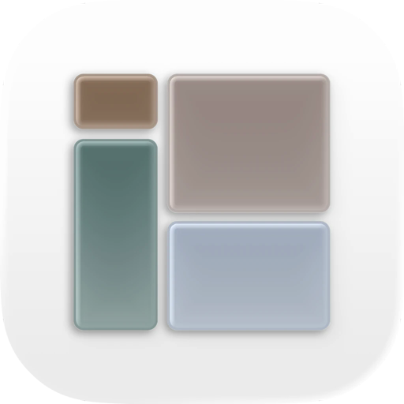
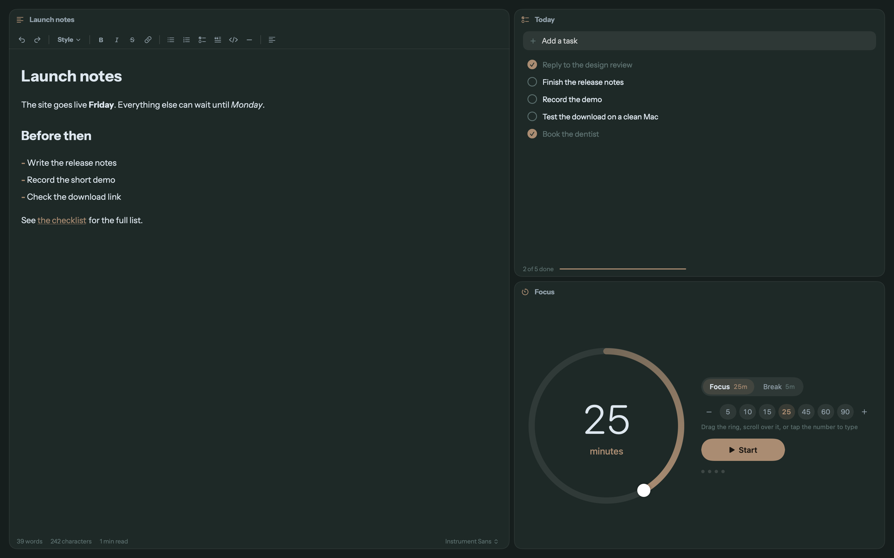

<p align="center">
  
</p>

<h1 align="center">Panels</h1>

<p align="center">
  Notes, terminals and web apps in one window.<br />
  A calm Mac workspace of resizable panels that keep running while you rearrange them.
</p>

<p align="center">
  <a href="https://getpanels.app"><b>Website</b></a> &nbsp;·&nbsp;
  <a href="https://github.com/thecatthatflies/panels/releases/latest"><b>Download</b></a> &nbsp;·&nbsp;
  <a href="https://buy.stripe.com/7sYeVd7Sw5fN6PH3nVaVa07"><b>Support Panels</b></a>
</p>

<p align="center">
  <picture>
    <source media="(prefers-color-scheme: light)" srcset="docs/img/panels-pale-sky.png" />
    
  </picture>
</p>

## What it is

Panels is a windowless macOS workspace. You fill one window with panels, and each panel is one of:

| Panel | What it does |
| --- | --- |
| **Note** | Markdown with a Docs style toolbar, links between notes, snippets, an outline, find and replace, and export to HTML or PDF. |
| **Terminal** | A real terminal on a pseudo terminal, with its own emulator, themes and fonts. |
| **Web** | Any site as a panel, with per-site zoom, find in page, downloads, tracker blocking and isolated sessions. |
| **Tasks** | A short list with a progress bar. |
| **Timer** | One adaptive focus dial: focus, break and long break. |

Panels are grouped into workspaces. Moving, resizing and re-tiling never restarts a terminal, a page or a timer.

## Highlights

- **Tile it for me.** Balanced, main, columns, rows and spiral layouts. Add a panel and the rest make room. Swap neighbors and resize from the keyboard.
- **Hard minimums.** Panels never shrink below a size where their content still fits. The window grows to what the workspace needs.
- **Lock In.** Hide everything except the panel you are in.
- **Undo a close.** Cmd Shift T reopens the last panel, workspace or pop-out you closed.
- **Pop out.** Float any panel in its own window, pinned above other apps if you like.
- **Dictation.** Speak into a note or a terminal with Apple's on-device speech recognition.
- **Themes.** Granite, Pale Sky, Taupe and Lavender, or build your own. One accent per theme.
- **Sound, only if you want it.** Soft interface sounds, typing sounds and ambient rain, all off by default.
- **Local first.** No account, no analytics. Notes and layouts are plain files on your Mac, with rolling backups.

## Install

1. Download `Panels.dmg` from the [latest release](https://github.com/thecatthatflies/panels/releases/latest).
2. Open it and drag Panels to Applications.
3. Open Panels from Applications.

Panels needs **macOS 26 or newer**.

> **First launch.** Release builds are not notarized yet, so macOS may say it cannot verify Panels. Open **System Settings, Privacy and Security**, scroll to the message about Panels and choose **Open Anyway**. You only do this once.

Panels updates itself. It checks for new releases, downloads them in the background and shows a **Restart to update** pill in the top bar. You can also check from Panels > Check for Updates.

## Keyboard

| Action | Keys |
| --- | --- |
| Command palette | Cmd K |
| New note / terminal / web | Cmd N / Cmd T / Cmd Shift B |
| Split right / down | Cmd D / Cmd Shift D |
| Zoom panel | Cmd Shift Return |
| Close panel | Cmd W |
| Reopen last closed | Cmd Shift T |
| Next / previous panel | Cmd ] / Cmd [ |
| Focus by direction | Cmd Option Arrows |
| Swap with neighbor | Cmd Option Shift Arrows |
| Resize focused panel | Cmd Control Arrows |
| Workspaces | Cmd 1 to 9, new with Cmd Shift N |

Drag a panel header onto the edge of another panel to dock it, or onto the middle to swap. Every command is also in the menus and the palette.

## Your data

Workspaces, notes, sites, templates and themes live in `~/Library/Application Support/Panels` as plain JSON, with rolling backups in a `Backups` folder. Settings has **Show Data in Finder**. Panels connects to the internet only to check GitHub for updates, to load web panels you add, and for the search you type in a web panel's address bar. See the [privacy policy](https://getpanels.app/privacy).

## Build from source

Requires Xcode 26 or newer and macOS 26. There are no third party packages.

```bash
xcodebuild -project Panels.xcodeproj -scheme Panels -configuration Debug -derivedDataPath build build
open build/Build/Products/Debug/Panels.app
```

Run the headless self test (it uses a scratch data folder and is silent):

```bash
scripts/selftest.sh build/Build/Products/Debug/Panels.app
```

Make a styled disk image from a built app:

```bash
scripts/make-dmg.sh build/Build/Products/Release/Panels.app Panels.dmg
```

Release builds use `-Osize`. The `-O` setting currently crashes the Swift compiler on this project, so the project pins it.

## How it is built

SwiftUI and AppKit, no third party code. One observable model (`Workspace`) owns every workspace and its layout tree. Native views for terminals, web pages and note editors are cached per panel, so layout changes never recreate them. `CLAUDE.md` has the architecture rules and a file map.

| Area | Where |
| --- | --- |
| Model, layout tree, persistence | `Models.swift`, `WorkspaceOps.swift`, `Persistence.swift` |
| Tiling and minimum sizes | `Tiling.swift`, `PanelSize.swift` |
| Notes | `NotePanel.swift`, `MarkdownEditor.swift`, `Writing.swift` |
| Terminal | `TerminalEmulator.swift`, `TerminalView.swift` |
| Web | `WebPanel.swift`, `WebSupport.swift`, `Sites.swift` |
| Themes and sound | `Theme.swift`, `ThemeStore.swift`, `Sound.swift` |
| Updater | `Updater.swift` |

## Releases

Every push to `main` runs `.github/workflows/release.yml`. It builds the app, runs the self test, and publishes a GitHub release (`v1.0.<run number>`) with two files:

- `Panels.dmg` for people installing for the first time
- `Panels.zip` for the in-app updater

## Support

Panels is free. If it earns a place in your day, you can [support it](https://buy.stripe.com/7sYeVd7Sw5fN6PH3nVaVa07). Questions and problems: `support@getpanels.app`.

## License

[MIT](LICENSE) © 2026 Aiyan Chowdhury. The Panels name and icon are not covered by the license. Instrument Sans is bundled under the [SIL Open Font License](Panels/Resources/Fonts/InstrumentSans-OFL.txt). See the [open source notices](https://getpanels.app/licenses).
